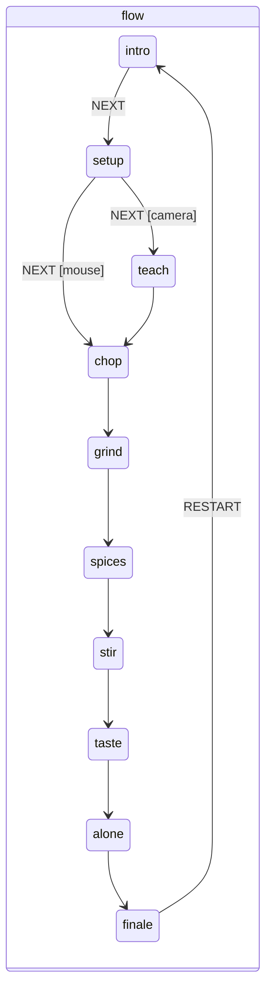

# What my hands remember — making curry with my mom

Creative Code 3 · Howest · Elana Van Impe Delmote

Cook one pot of curry next to my mom by copying her hands with your webcam.
ml5.js (HandPose, FaceMesh, a self-trained neural network) + GSAP (ScrollTrigger, SplitText, DrawSVG, MorphSVG, MotionPath, ScrollTo).

## Run it

```bash
npx serve          # in this folder, then open the localhost link
```
The camera only works on `https://` or `localhost`, and ES modules don't load from `file://`.
Add `?debug` to the URL (or press **D**) for the state panel: live state of every machine, jump to any step, simulate a lost camera.

## Deliverables (experiment & research phase, 17 Nov)

| Deliverable | Where |
|---|---|
| ml5: 2+ prebuilt models **and** 1 self-trained model | HandPose: `e1`, `e2`, `e4`, `e8` · FaceMesh: `e6` · self-trained NN (open / fist / pinch): `e5` |
| GSAP: ScrollTrigger + 2 more plugins | `e3-colour-scroll` (ScrollTrigger, DrawSVG) · `e7-gsap-cooking` (ScrollTrigger pin/scrub, SplitText, MorphSVG, DrawSVG, MotionPath, ScrollTo, `gsap.matchMedia`) |
| Meaningful mapping: ML signals → animation | `e8-mapping` (5 mapping types, editable ranges/curves/smoothing) + used in `e4`, `e5`, `e6` |
| Final application skeleton with state handling | `index.html`, `css/`, `js/` (below) |
| Technical limitations | `e9-limitations` + `docs/TECHNICAL-LIMITATIONS.md` + `js/core/system-check.js` |
| Log of every experiment | `experiments/LOG.md` |

Every experiment is one standalone page in its own folder, works in **mouse mode** without a camera (for demos), and has a test plan + "log this round" button that writes a line you can paste into `LOG.md`.

| Folder | Question |
|---|---|
| `e0-camera` | Does the camera work? |
| `e1-handpose` | Under which conditions (backend, model, light) does HandPose run fast enough? |
| `e2-chop` | Can a chop become exactly one slice, and can it tell "too fast"? |
| `e3-colour-scroll` | How can scroll transitions feel fun? (ScrollTrigger + DrawSVG) |
| `e4-circles` | Can circling become "turns" + "speed", fist (grind) vs open hand (stir)? |
| `e5-pinch-classifier` | Can a network trained on the visitor's hands make one pinch = one spice? |
| `e6-taste-facemesh` | Smile vs "too spicy" face after a neutral calibration? |
| `e7-gsap-cooking` | All the cooking animations, scroll-driven |
| `e8-mapping` | Which kinds of mapping make a hand signal feel like cooking? |
| `e9-limitations` | What can go wrong, can the page notice it, what does it do then? |

`experiments/shared/` holds the common look (`exp.css`) and helpers (`exp.js`: camera start, error messages, palm-based measurements, logging).

## Project structure

```
index.html              all scenes (one <section class="step"> per recipe step), HUD, notice, debug panel
css/style.css           paper palette, Fraunces + DM Mono
js/
  main.js               boot + step runner (exit old step → clean up → switch scene → pick detector → enter new step)
  state.js              ALL state: the machines + a store for live values
  story.js              all text
  ui.js                 status light, progress dots, toast, notice, debug panel
  core/
    machine.js          tiny finite state machine (only listed transitions are allowed)
    store.js            tiny reactive store
    bus.js              events from inputs to steps ('hand', 'face', 'shape')
    mapping.js          signal → animation parameter (from e8)
    system-check.js     detect + explain technical limitations (from e9)
  input/
    camera.js           webcam life cycle → camera machine
    models.js           lazy ml5, HandPose / FaceMesh loading, one detector at a time, pause when hidden
  ml/classifier.js      self-trained open / fist / pinch network (+ distance-rule fallback)
  gestures/             detectors ported from the experiments: chop, circle, pinch, taste, hand helpers
  steps/                one module per step: { id, detector, enter(ctx), exit(ctx) }
  lib/                  ml5 1.4.0, GSAP 3.15.0 + plugins
experiments/            e0 … e9, LOG.md
docs/                   TECHNICAL-LIMITATIONS.md
```

### How a step works

```js
export default {
  id: 'chop',
  detector: 'hand',            // which model runs while this step is active ('hand' | 'face' | null)
  enter(ctx) {
    ctx.on('hand', hand => …);            // bus events, removed automatically on exit
    ctx.listen(el, 'click', …);           // DOM listeners, removed automatically
    ctx.later(() => ctx.next(), 1800);    // timers, cleared automatically
    ctx.say('…'); ctx.hint('…'); ctx.progress(0.5);
    ctx.mode;                             // 'camera' | 'mouse' (live)
  },
  exit(ctx) { /* optional extra cleanup */ }
};
```
Because every listener and timer goes through `ctx`, leaving a step (or jumping with the debug panel) never leaves a detector or a `setTimeout` running in the background.

## State handling

Seven machines run side by side. Each one only accepts the transitions in its table, so a late callback (e.g. a model that finishes loading after the visitor switched to mouse) can't put the app in an impossible state. `document.body` gets a `data-*` attribute per machine, so CSS can react (`body[data-input="mouse"] .mouse-only`).



| Machine | States | Notes |
|---|---|---|
| `flow` | intro → setup → teach → chop → grind → spices → stir → taste → alone → finale | `NEXT`, `GOTO` (progress dots, debug), `RESTART`. Mouse mode skips `teach`. |
| `input` | none → camera ⇄ mouse | `FALLBACK` = camera failed → mouse |
| `camera` | idle → requesting → on → lost · denied · missing · busy · insecure · error | `RETRY` from every error except insecure |
| `handPose`, `faceMesh` | idle → loading → ready / error | 45 s timeout; FaceMesh preloads during `stir` |
| `classifier` | untrained → collecting ⇄ recording → training → ready | `TRAIN` guarded: ≥ 15 samples per shape |
| `session` | running ⇄ paused (tab hidden) · blocked (camera lost) | detection stops when not running |

Live values (fps, TF backend, light, hand framing, samples, warnings) live in `values` (`js/state.js`).

Each step also has its own small sub-state (e.g. chop: chopping ⇄ too-fast → done; taste: calibrating → tasting → spicy (yogurt) → tasting → right).

## Still to do (after 17 Nov)

- Replace the `.mom-hands` placeholders with the filmed video of mom's hands.
- Final illustrations (pencil style from the storyboard) instead of the placeholder SVGs.
- Tune thresholds with the E9 prototype test (5 people).
- Investigate self-hosting the model weights (see limitation #16).
